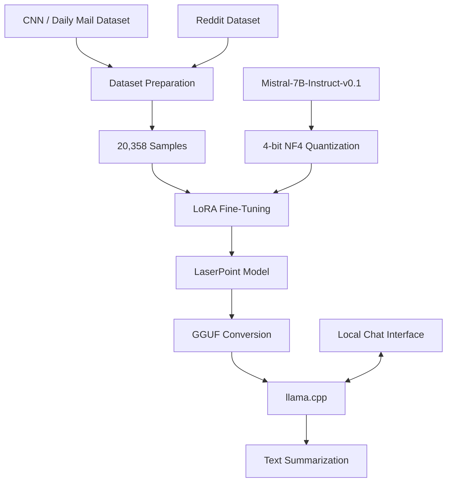

<div align="center">

# LaserPoint

### Fine-Tuning a Large Language Model for Summarization

An experimental project exploring parameter-efficient fine-tuning of Mistral-7B-Instruct, GGUF conversion, and local inference.

<br/>


</div>

---

## Overview

**LaserPoint** is a fine-tuned language model developed as part of a research internship at Digital University Kerala.

The project investigates adapting Mistral-7B-Instruct-v0.1 for abstractive text summarization through supervised fine-tuning and Low-Rank Adaptation (LoRA).

The workflow extends beyond training to model conversion and local deployment, enabling summarization through a lightweight browser-based interface.

## Project Pipeline



## Technical Approach

### 1. Dataset Preparation

- Consolidated datasets from CNN / Daily Mail and Reddit.
- Prepared supervised fine-tuning samples in JSONL format.
- Final dataset contained **20,358 samples**.

### 2. Model Fine-Tuning

The base model was loaded using 4-bit quantization to reduce memory requirements during training.

| Parameter | Configuration |
|---|---|
| Base model | Mistral-7B-Instruct-v0.1 |
| Fine-tuning | Supervised Fine-Tuning |
| Adaptation | LoRA |
| Quantization | 4-bit NF4 |
| LoRA Rank | 16 |
| LoRA Alpha | 32 |
| LoRA Dropout | 0.05 |
| Training Epochs | 3 |
| Training Steps | 7,635 |
| Training Environment | Google Colab |

Training utilized Hugging Face Transformers, PEFT, and BitsAndBytes.

### 3. GGUF Conversion

The fine-tuned model was converted into GGUF format for compatibility with llama.cpp.

This enabled efficient local model execution without requiring the original Hugging Face training environment.

### 4. Local Inference

LaserPoint was executed locally through llama.cpp.

A lightweight HTML interface communicates with the local inference server through an OpenAI-compatible API endpoint, allowing users to submit text and receive generated summaries through a browser.

## Technology Stack

| Category | Technologies |
|---|---|
| Model | Mistral-7B-Instruct-v0.1 |
| Training | Transformers, PEFT, BitsAndBytes |
| Fine-Tuning | LoRA, 4-bit NF4 |
| Dataset | Hugging Face Datasets, JSONL |
| Conversion | GGUF |
| Inference | llama.cpp |
| Interface | HTML, JavaScript |
| Environment | Google Colab |

## Repository Structure

```text
LaserPoint-Summarizer/
├── Untitled17.ipynb
├── chat.html
├── docs/
│   └── architecture.md
├── README.md
└── .gitignore
```

## Demonstration

The project demonstrates a complete experimental workflow:

- Preparing a summarization dataset
- Fine-tuning a 7B language model using LoRA
- Converting the model into GGUF
- Running inference locally
- Interacting with the model through a browser interface

## Limitations

- Experimental summarization model; not benchmark-certified.
- Generated summaries may omit details or introduce inaccuracies.
- Model performance depends on training data and configuration.
- Local inference requires separately obtained model artifacts and compatible runtime software.

## Acknowledgment

Developed during a research internship at **Digital University Kerala**, exploring LLM fine-tuning, summarization, and local model deployment.

---

<div align="center">

**LaserPoint · Research · Fine-Tuning · Local AI**

</div>
