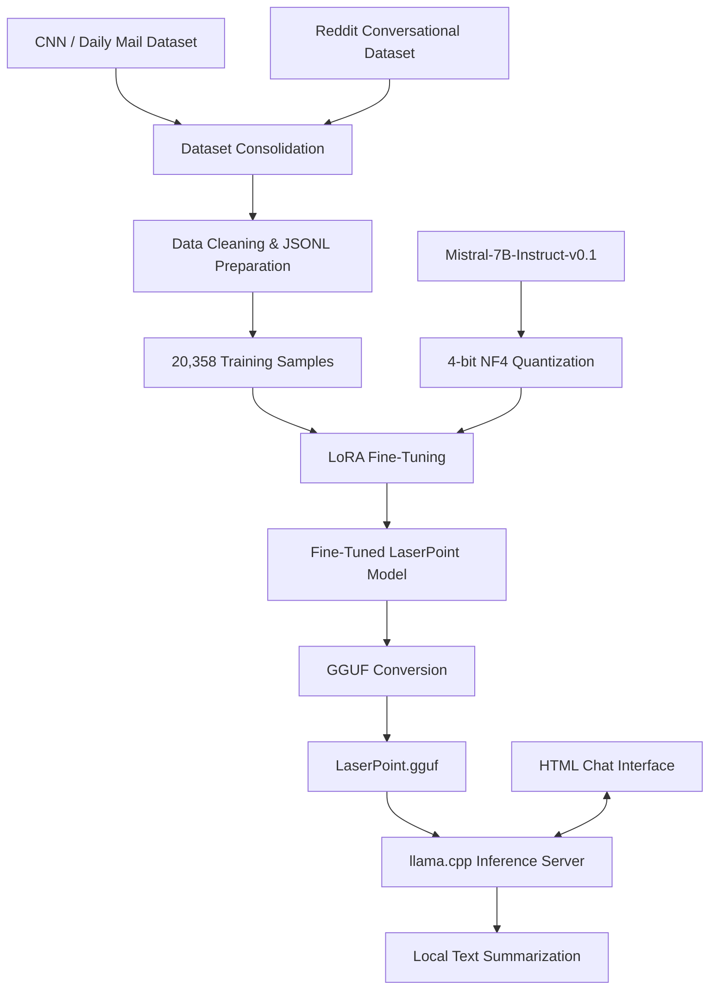

# LaserPoint — System Architecture

## Overview

LaserPoint follows a pipeline that transforms source text datasets into a locally deployable summarization model.

## Architecture

## Pipeline Description

### 1. Dataset Preparation
Data from CNN / Daily Mail articles and Reddit conversational samples was consolidated, cleaned, and converted into JSONL format.

### 2. Model Fine-Tuning
Mistral-7B-Instruct-v0.1 was loaded using 4-bit NF4 quantization. LoRA was applied for parameter-efficient supervised fine-tuning.

### 3. Model Conversion
The fine-tuned model was converted into GGUF format for compatibility with llama.cpp.

### 4. Local Deployment
The GGUF model was executed locally using llama.cpp. A lightweight HTML interface communicates with the local inference server through an OpenAI-compatible API.

## Deployment Components

| Component | Purpose |
|---|---|
| LaserPoint.gguf | Local model artifact |
| llama.cpp | Model inference runtime |
| llama-server | API-compatible inference server |
| chat.html | Browser-based interaction interface |
